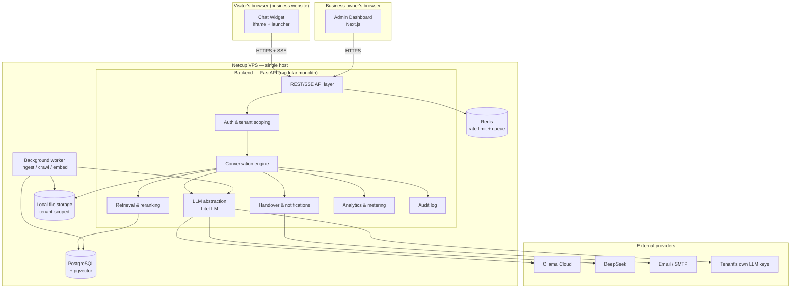
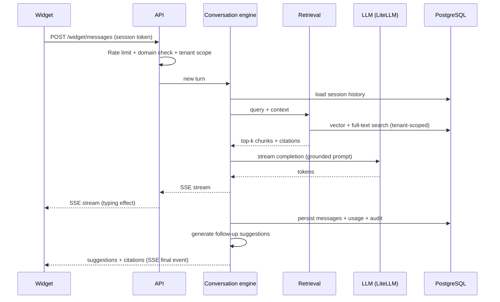
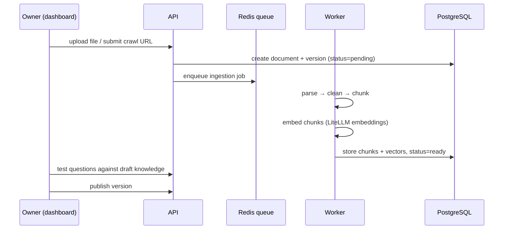
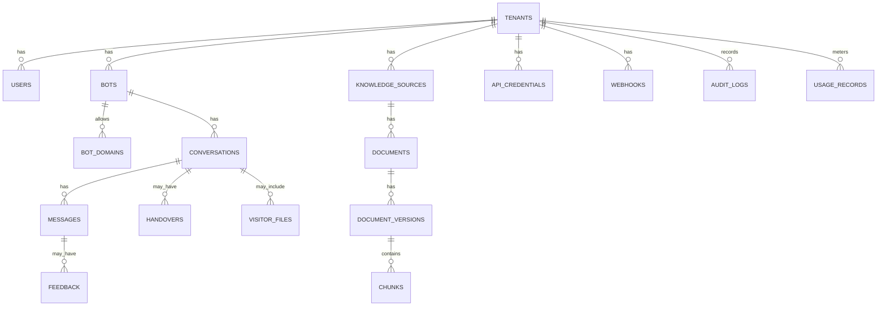

# EVA — Frozen Architecture (generated from blueprint, 2026-11-15)
---


---

> LOCKED by the gate constitution (docs/PLAN.md G1). The build loop may NOT edit this file;
---

> changes require a user ruling that deliberately updates the checksum recorded in
---

> tests/test_locked_docs.py. Source of full text: docs/spec/blueprint-full.md
---


---

## 2. Confirmed Requirements and Assumptions

### 2.1 Requirements Register

| # | Requirement | Priority |
|---|------------|----------|
| R1 | Commercial SaaS, multi-tenant | MVP |
| R2 | Target: small businesses (1–50 employees) | MVP |
| R3 | Prototype first, then market to potential customers | MVP |
| R4 | Industries: e-commerce, hospitality, professional services (non-regulated) | MVP |
| R5 | Problem: reduce support tickets, instant answers, after-hours coverage | MVP |
| R6 | Inbound agent (reactive, not outbound marketing) | MVP |
| R7 | Developed by AI agent (OpenHands) | Constraint |
| R8 | Greenfield project | Constraint |
| R9 | Host: Netcup VPS (same host as OpenHands dev) | Constraint |
| R10 | Minimal infrastructure cost for prototype | Constraint |
| R11 | Timeline: quality over speed | Constraint |
| R12 | Stack chosen on merit + AI-agent development friendliness | Constraint |
| R13 | Multi-tenant SaaS; single-tenant as later enterprise feature | MVP |
| R14 | LLM keys: platform-managed AND bring-your-own-key (BYOK) | MVP |
| R15 | Existing keys: Ollama Cloud + DeepSeek | Constraint |
| R16 | Voice architected for, not built in MVP | Deferred |
| R17 | ElevenLabs subscription available | Constraint |
| R18 | Knowledge priority: file uploads > website crawling > FAQ entry > cloud storage > API KBs > DB | MVP (first 3) |
| R19 | Handover MVP: email notification + contact form | MVP |
| R20 | Handover V1: ticket creation in existing systems + agent inbox | V1 |
| R21 | Business integrations deferred; connector architecture ready | Deferred |
| R22 | Integration priority when built: Shopify, Calendly/Cal.com, Stripe | Future |
| R23 | Widget: JavaScript embed snippet | MVP |
| R24 | English-only MVP; multilingual fast-follow | MVP |
| R25 | Read-only AI; actions architecture-ready | MVP |
| R26 | Dashboard: config, knowledge, conversations, basic analytics, settings | MVP |
| R27 | Suggested questions: proactive + dynamic follow-ups | MVP |
| R28 | Auth: email+password; SSO/OAuth-ready schema | MVP |
| R29 | Audit logs | MVP |
| R30 | Compliance: GDPR + US (CCPA/CPRA and similar state laws) | MVP |
| R31 | Analytics: basic (count, latency, tokens); intermediate V1 | MVP |
| R32 | Conversation transcript / email export | MVP |
| R33 | Visitor contact form (name + email) | MVP |
| R34 | Widget customisation (colours, position, avatar, launcher) | MVP |
| R35 | Typing indicator + streaming responses | MVP |
| R36 | Rate limiting per visitor | MVP |
| R37 | Conversation timeout / session management | MVP |
| R38 | Mobile-responsive widget | MVP |
| R39 | "Powered by" branding toggle | MVP |
| R40 | CSAT (thumbs up/down on responses) | MVP |
| R41 | Cookie-consent integration (defer storage until chat opened) | MVP |
| R42 | Conversation history for returning visitors (opt-in) | MVP |
| R43 | Business hours / offline behaviour | MVP |
| R44 | Webhook notifications (new conversation, handover) | MVP |
| R45 | File upload by visitor (screenshot, document) | MVP |

### 2.2 Assumptions (provisional, flagged for validation)

- **A1:** Prototype tenancy is row-level isolation in one PostgreSQL database (tenant_id on every row + enforced query scoping). Enterprise single-tenant later.
- **A2:** Expected prototype load: ≤ 50 businesses, ≤ 10,000 conversations/month total, ≤ 5 concurrent streams. Capacity model in §22.
- **A3:** The Netcup VPS has ≥ 4 GB RAM and ≥ 40 GB disk available for this project. Must be verified before deployment.
- **A4:** "Minimal cost" = €0 incremental hosting (existing VPS), LLM spend pay-as-you-go on existing Ollama/DeepSeek keys.
- **A5:** R45 (visitor file upload) is scoped to images + PDF only, ≤ 5 MB, stored in local filesystem with tenant-scoped paths. S3-compatible storage is a config swap later.

### 2.3 Outstanding Decisions (not blocking architecture)

- **D1:** Product name / domain — needed before launch, not before coding.
- **D2:** Exact Netcup VPS specs and whether OpenHands dev + production can cohabit — verify at deployment.
- **D3:** Whether the platform itself is the data processor or a sub-processor chain includes Ollama/DeepSeek — affects the DPA template. Flagged in §21.

---
---

### 4.1 Pricing Landscape

| Vendor | Billing model | Entry price | AI cost per unit |
|--------|--------------|-------------|------------------|
| Intercom (Fin) | Per seat + per AI resolution | $29/seat/mo | ~$0.99/resolution |
| Zendesk AI | Per agent + per AI resolution | $19/agent/mo | ~$2.00/extra resolution |
| Gorgias | Per ticket tier | $10 for 50 tickets | ~$0.90–1.00/interaction |
| Tidio | Per conversation + AI add-on | ~$24/mo for 100 conv. | ~$32.50 per 50 conversations |
| Crisp | Flat workspace + bundled credits | Free, then $45/mo | ~$5 per 90 conversations (3rd-party est.) |
| Chatbase | Monthly message-credit tiers | Free, then $40/mo | ~$40 per 1,000 credits |
| Botpress | Conversation packs + AI spend | Free, then ~$150/mo | ~$65 per 100 conversations |
| ProxyAI | Pay-per-use | $0 | ~$0.30/ticket resolution |

### 4.2 Market Gaps Relevant to This Product

1. **Seat-based pricing excludes the target customer.** A 1–3 person business will not pay $29/seat + $0.99/resolution. A free tier + usage-based pricing is the entry point.
2. **Helpdesk coupling.** Intercom/Zendesk/Gorgias AI only works inside their helpdesk. A standalone widget + lightweight email handover serves businesses that have no helpdesk and don't want one.
3. **Provider independence.** All listed competitors tie you to their model choices and their margin. BYOK is a differentiator for cost-conscious and privacy-conscious buyers.
4. **GDPR posture as a feature.** ChatterLab demonstrates that a widget designed to store nothing before the visitor opens the chat is a selling point in the EU. This is cheap to build if designed in from the start (§14, §21).

### 4.3 Positioning

**Position on: easy deployment + no helpdesk required + provider independence + EU-friendly privacy.** Do not try to out-feature Intercom; win the customer Intercom prices out.

---
---

## 7. Future Product Roadmap

- **V1 (post-validation):** cloud storage connectors, Zendesk/Freshdesk ticket creation, simple agent inbox, multilingual, intermediate analytics (resolution rate, knowledge-gap report), WordPress plugin.
- **V2 (commercial):** voice via ElevenLabs, Shopify/Calendly/Stripe connectors with read-only lookups, SSO/OAuth, Stripe billing, usage metering, white-label/agency tier.
- **V3 (enterprise):** single-tenant deployments, data residency options, AI write-actions with approval gates, SOC 2 programme.

---
---

## 8. Recommended Architecture

### 8.1 Architecture Style: Modular Monolith

**Decision: modular monolith, not microservices.** Rationale:
- One AI agent develops and maintains this; one deployable unit minimises cross-service debugging.
- Prototype load (A2) does not justify distributed systems.
- Module boundaries are enforced in code (packages with explicit interfaces), so extraction to services later is a mechanical refactor, not a redesign.
- The only separately-deployed processes: the background worker (document ingestion/crawling) and the widget static host — both justified by different runtime profiles, not by fashion.

### 8.2 High-Level System Diagram



### 8.3 Module Boundaries (within the monolith)

| Module | Responsibility | Future extraction trigger |
|--------|---------------|---------------------------|
| `auth` | Email+password sessions, tenant membership, RBAC | SSO adds provider integrations — still in-process |
| `tenancy` | Tenant resolution, row-level scoping, domain verification | Single-tenant deployments |
| `widget_api` | Public unauthenticated-ish endpoints (session token only), CORS, domain checks | High traffic → separate autoscaled service |
| `conversation` | Turn loop, memory, suggested questions, CSAT | Never urgent — core IP |
| `retrieval` | Chunk store, embedding lookup, hybrid search, rerank | >10M vectors → Qdrant (§12) |
| `llm` | LiteLLM wrapper, routing, fallback, BYOK decryption, token metering | Never — abstraction is the point |
| `ingestion` | Parse, clean, chunk, embed, version | Heavy crawl volume → dedicated workers |
| `handover` | Contact form, email notify, transcript compile | V1 ticket integrations plug in here |
| `voice` | **Empty interface module now** — defines VoiceProvider protocol so V2 drops in | V2 implementation |
| `integrations` | **Empty connector registry now** — defines Connector protocol | V2 implementation |
| `analytics` | Event capture, aggregation queries, cost per conversation | Large volume → columnar store |
| `audit` | Append-only audit events | Never |

### 8.4 Key Data Flows

**Conversation turn:**


**Knowledge ingestion:**


**Handover:**
```mermaid
sequenceDiagram
    participant V as Visitor
    participant C as Conversation engine
    participant H as Handover module
    participant E as Email (SMTP)
    participant O as Business owner

    V->>C: "I want to speak to a human" (or low-confidence trigger)
    C->>H: escalate(conversation, reason)
    H->>H: collect contact form if email unknown
    H->>E: transcript + contact + reason
    E-->>O: notification email
    H->>C: mark conversation handed_over; AI stops answering
    V->>C: sees "we'll be in touch" + optional further messages queued
```

---

## 9. Technology Stack Comparison and Recommendation

### 9.1 Backend: Python 3.12 + FastAPI ✅

| Candidate | Pros | Cons | Verdict |
|-----------|------|------|---------|
| **Python + FastAPI** | Best AI/LLM ecosystem (LiteLLM, parsing libs, sentence-transformers); async native; Pydantic validation; OpenAPI auto-generated; easiest for OpenHands to write correct code in | Slightly slower raw throughput than Node — irrelevant next to LLM latency | **Chosen** |
| Node.js + NestJS | Same language as dashboard; good structure | Weaker document-parsing/ML ecosystem; two AI stacks to bridge | Rejected |

### 9.2 Admin Dashboard: Next.js (React) ✅

| Candidate | Pros | Cons | Verdict |
|-----------|------|------|---------|
| **Next.js** | Huge ecosystem, server components, easy deploy, OpenHands writes it fluently | Slightly heavier than Svelte/Vue | **Chosen** |
| Vue/Nuxt | Simpler learning curve | Smaller hiring/component ecosystem | Rejected |

### 9.3 Widget: framework-free Web Component loading an iframe ✅

| Approach | Pros | Cons | Verdict |
|----------|------|------|---------|
| **Loader script → iframe** | Total CSS/JS isolation from host page; no framework version conflicts; CSP-friendly; one tiny loader (<10 KB) | Cross-origin messaging needed (postMessage) | **Chosen** |
| Web Component (Shadow DOM) | No iframe | CSS bleed edge cases, harder CSP story, heavier on host page | Rejected |
| React component injected | Easy dev | Conflicts with host site's React; huge anti-pattern for embeds | Rejected |

### 9.4 Database: PostgreSQL 16 + pgvector ✅

Source: Feezan Khattak's production comparison (2026-08-24) and Kalvium Labs' multi-production comparison (2026-04-02) both converge on "pgvector until a named limit."

| Candidate | Verdict |
|-----------|---------|
| **pgvector** | **Chosen.** One DB for relational + vectors; transactions with business data; existing backup/restore; comfortable to ~10M vectors; ~8–25 ms p95 at moderate scale — invisible next to 800 ms LLM calls. |
| Qdrant | Migration target if filtered (tenant-scoped) vector search degrades or >10M vectors. Self-hostable, strong payload filtering. |
| Pinecone | Rejected: monthly premium (~$180 vs ~$0 incremental) contradicts R10. |
| Weaviate/Milvus | Rejected for MVP: more ops burden, no advantage at this scale. |

**Interface rule (from research):** all vector access goes through a `VectorStore` interface so Qdrant is a config swap, not a rewrite. Re-embedding cost on migration is acknowledged and documented.

### 9.5 AI Orchestration: Direct SDK + LiteLLM ✅ (no LangChain in the hot path)

Source: RecaTools' July 2026 comparison of LangChain 1.3.x / LangGraph 1.2.x / LlamaIndex 0.14 + Workflows 2.22.

| Candidate | Verdict |
|-----------|---------|
| **LiteLLM (proxy/SDK)** | **Chosen for model abstraction only.** Unified chat/embedding API across Ollama, DeepSeek, OpenAI, Anthropic, Gemini; token accounting; BYOK passthrough. This is the only AI-framework dependency in the conversation path. |
| LangChain 1.x `create_agent` | Good for agents; **overkill for a RAG chat loop** and adds a moving dependency. The 1.x stability pledge reduces but doesn't eliminate churn risk. Revisit for V2 tool-use agents. |
| LangGraph | Rejected for MVP: own docs call it low-level, not for beginners; durable-execution features unneeded at this scope. Revisit for V2 multi-step action workflows. |
| LlamaIndex | **Adopt selectively for ingestion only if parsing needs exceed hand-rolled** — its identity is document parsing/indexing (LlamaParse). Evaluate during Phase 4; do not build the conversation engine on it. |

### 9.6 Queue/Cache: Redis ✅ (rate limiting + job queue via RQ or arq)

### 9.7 Document Parsing

- PDF: **pypdf** first, **pdfplumber** for tables; OCR (scanned PDFs) = **Tesseract** optional flag (marked best-effort).
- Word: **python-docx**. PowerPoint: **python-pptx**. Excel/CSV: **pandas**.
- Crawling: **httpx + BeautifulSoup/trafilatura** for MVP (static pages). JS-rendered crawling (Playwright) is a flagged V1 upgrade — MVP crawler documents its limitation honestly.

### 9.8 Observability: structured logs (structlog) + Prometheus metrics + Grafana (light, self-hosted) — OpenTelemetry traces on the conversation path.

### 9.9 Full Stack Summary

```
Widget:     vanilla TS loader + iframe app (Preact, <30 KB gz)
Dashboard:  Next.js 15, Tailwind, shadcn/ui
Backend:    Python 3.12, FastAPI, Pydantic v2, SQLAlchemy 2 + Alembic
DB:         PostgreSQL 16 + pgvector
Queue:      Redis + arq
LLM:        LiteLLM (Ollama Cloud, DeepSeek; OpenAI/Anthropic/Gemini via config)
Storage:    local FS (S3-compatible interface)
Email:      SMTP (transactional provider configurable)
Deploy:     Docker Compose on Netcup VPS; Caddy for TLS
CI:         GitHub Actions
```

---

## 10. Knowledge Management and RAG Architecture

### 10.1 Ingestion Pipeline

```
Source (upload | crawl | FAQ)
  → Parse (per-type parser)
  → Clean (boilerplate removal, dedup)
  → Chunk (structure-aware)
  → Embed (configurable model, per-tenant)
  → Store (tenant-scoped chunks + vectors, versioned)
  → Preview/test (owner asks questions against draft)
  → Publish (atomic version swap)
```

### 10.2 Chunking Strategy (research-backed priority — chunking dominates answer quality)

- **Default: recursive structure-aware chunking** — split on document structure (headings, sections) first, then paragraphs, then sentences; target ~400–800 tokens per chunk with 10–15% overlap.
- FAQ entries = one chunk per Q&A pair (no splitting).
- Tables (CSV/Excel) = row-group chunks with the header repeated in each chunk; a text summary of the table is also embedded.
- Trade-off accepted: no single strategy fits all; the chunker is per-source-type configurable, and the test/preview UI (R26) is how owners validate quality.

### 10.3 Retrieval: Hybrid Search + Rerank

1. **Dense:** pgvector HNSW cosine similarity, tenant-filtered (`WHERE tenant_id = … AND knowledge_version = published`).
2. **Sparse:** PostgreSQL full-text search (`tsvector`) on the same chunks table — BM25-equivalent without new infrastructure.
3. **Merge:** Reciprocal Rank Fusion of the two ranked lists.
4. **Rerank (optional, on by default):** cross-encoder or LLM-based rerank of top-20 → top-5. Configurable per tenant (cost/latency trade-off).
5. **Threshold:** below a similarity/confidence floor → the AI says it doesn't know and offers handover (R19) instead of guessing. This is the primary hallucination control.

### 10.4 Answer Grounding

- Prompt contract: answer **only** from retrieved chunks; if none are relevant, decline + escalate.
- Every answer carries **source citations** (document name + section + URL where applicable), rendered in the widget.
- Retrieved content is treated as **untrusted data**, never as instructions — delimiter-wrapped, with explicit prompt-injection resistance instructions (§21).

### 10.5 Versioning and Refresh

- Every ingestion creates a new `document_version`; chunks belong to a version.
- Publishing swaps the tenant's `active_version` pointer — instant rollback by re-pointing.
- Crawl sources have a configurable refresh schedule (daily/weekly) via the worker.
- Conflicting duplicates: dedup by content hash at ingestion; conflicts surfaced to the owner in the dashboard, never silently resolved by the AI.

### 10.6 Multilingual / Images / Scanned PDFs

- English-only retrieval path in MVP (R24). Embedding model choice (§11) keeps multilingual options open.
- Images in documents: extracted, captioned by a multimodal model if configured; otherwise skipped with a processing note. Visitor-uploaded images (R45) use a vision-capable model when available.
- Scanned PDFs: OCR flag, best-effort, quality warning shown to owner.

---

## 11. AI Provider and Model Strategy

### 11.1 Abstraction

LiteLLM SDK in the `llm` module. Model identifiers are **config strings, never hardcoded**. Per-tenant resolution order: tenant BYOK → platform default → fallback chain.

### 11.2 Providers

| Provider | Role in MVP | Notes |
|----------|-------------|-------|
| Ollama Cloud (DeepSeek v4 family) | Platform default | Key already held (R15). Verified model ids in Talos memory: `deepseek-v4-pro:0813`, `deepseek-v4-flash:0731`, `deepseek-v4.1-flash`. |
| DeepSeek direct API | Fallback/alternative | `deepseek/deepseek-v4-flash`, `deepseek/deepseek-reasoner` via LiteLLM. |
| OpenAI / Anthropic / Gemini | BYOK or later platform options | Added by LiteLLM config only — no code changes. |

### 11.3 Task-Based Model Routing (MVP-simple, extensible)

| Task | Model class | MVP default |
|------|-------------|-------------|
| Answer generation | Quality chat model | deepseek-v4-pro |
| Suggested questions / follow-ups | Fast cheap model | deepseek-v4.1-flash |
| Query rewriting + intent check | Fast cheap model | deepseek-v4.1-flash |
| Summarisation (handover transcript) | Fast cheap model | deepseek-v4.1-flash |
| Embeddings | Dedicated embedding model | see §11.4 |

### 11.4 Embedding Model Choice

Source: PremAI's 2026 embedding comparison (MTEB scores, 2026-03-17) and Ergini's cost comparison.

**MVP default: OpenAI `text-embedding-3-small` ($0.02/1M tokens) when an OpenAI key is present; otherwise self-hosted BGE-M3 (MIT licence, free, 100+ languages, 1,024 dims, dense+sparse in one model) on the VPS.**

- BGE-M3 aligns with R10 (cost) and R30 (no data leaves the VPS for embeddings) and its sparse output complements hybrid search.
- Upgrade path documented: voyage-3-large ($0.06/1M, best accuracy/cost among managed) or Qwen3-Embedding-8B (Apache 2.0, self-host) if retrieval evals demand it.
- **Re-embedding warning:** changing embedding models requires re-ingesting the corpus; surfaced in the admin UI before any model switch.

### 11.5 Cost Controls

- Per-visitor rate limits (R36) and per-tenant monthly token budgets with hard stop.
- Response caching for identical normalised questions within a tenant (short TTL, invalidated on knowledge publish).
- Token usage metered per conversation (R31) — the foundation for later billing.
- Provider fallback with circuit breaker: on provider outage, fall back to secondary; if all fail, show offline message + handover form (never an error page).

---

## 12. Website Widget Architecture

### 12.1 Installation

```html
<script src="https://cdn.<platform>/loader.js" data-bot="BOT_PUBLIC_ID" defer></script>
```

### 12.2 Design

- **Loader (<10 KB):** reads config, verifies the page domain against the tenant's allowed-domains list, renders the launcher button, and creates the iframe **only when the visitor clicks** (GDPR — §21.4: nothing stored or loaded into the chat before the visitor asks for it).
- **Chat app (iframe, Preact):** isolated CSS/JS; communicates with the loader via `postMessage` (resize, close, consent signals).
- **Streaming:** SSE from the backend; typing indicator; markdown rendering; citation chips; CSAT buttons per answer; suggestion chips above the input.
- **Customisation (R34):** colours, launcher icon/avatar, position (bottom-right/left), welcome message, bot name — all from the dashboard, no code.
- **Mobile (R38):** full-screen sheet on small viewports; touch targets ≥ 44 px.
- **Accessibility:** WCAG 2.1 AA — focus trap in the open widget, ARIA live regions for streamed messages, keyboard operable.
- **Sessions:** session-scoped storage only (R37, R41). Conversation resumes across page reloads within the same tab session; tab close = new conversation unless the visitor opts into being remembered (R42 — explicit consent checkbox, durable identifier only then).
- **Offline/business hours (R43):** tenant's hours + timezone; outside hours the widget shows the offline message and leads with the contact form.
- **File upload (R45):** image/PDF ≤ 5 MB, type-sniffed server-side, stored tenant-scoped, sent to a vision model if configured.
- **"Powered by" (R39):** shown by default; toggleable per plan.
- **Versioning:** loader is versioned and cached with short TTL; breaking changes ship under a new loader path.

### 12.3 Tenant Isolation on the Widget

- The public bot id is not a secret — security comes from **allowed-domain verification + per-session signed tokens**, not from hiding ids.
- Every widget API call requires a short-lived session token issued by the backend for that bot+domain; cross-tenant access is impossible by query scoping (tenant_id derived server-side from the token, never from client input).

---

## 13. Human Handover Architecture (MVP)

1. **Triggers:** explicit visitor request; low-confidence retrieval (below threshold); negative CSAT; owner-defined keywords.
2. **Flow:** trigger → contact form (if email unknown) → conversation locked to AI → transcript compiled (with summary via cheap model) → email to the business's configured address (R19) → optional webhook (R44).
3. **After handover:** visitor can still send messages; they're appended to the transcript and forwarded, but the AI does not answer.
4. **V1 expansion points (built as interfaces now):** `HandoverChannel` protocol — `EmailChannel` (MVP), later `ZendeskChannel`, `FreshdeskChannel`, `AgentInboxChannel`. Conversation records store `handover_reason`, `outcome`, timestamps for later reporting.

---

## 14. Integration Framework (Future-Ready, Not Built)

```python
class Connector(Protocol):
    key: str                      # "shopify", "calendly"
    def authorize(self, tenant) -> OAuthFlow: ...
    def test(self, tenant) -> HealthCheck: ...
    def read(self, tenant, operation, params) -> ReadResult: ...
    # V3 only, with approval gates:
    def write(self, tenant, operation, params, *, confirmation) -> WriteResult: ...
```

- MVP ships the **registry, credential vault references, and read-only semantics** — zero concrete connectors (R21).
- Standards evaluation for later: REST/OpenAPI + OAuth 2.0 for SaaS connectors (established); webhooks for events (established); MCP is evaluated as an **emerging** standard for exposing tools to the LLM — decision deferred to V2, not assumed.
- Write actions (V3) require: explicit user confirmation in the widget, idempotency keys, audit trail, and per-operation permission scopes. Read vs write are separate protocol methods so read-only can never silently become read-write.

---

## 15. Voice Architecture (Future-Ready, Not Built)

- `VoiceProvider` protocol defined now: `start_session / stream_audio / interrupt / end_session`, plus events (partial transcript, turn end, barge-in).
- ElevenLabs Conversational AI is the first planned implementation (R17); the protocol prevents lock-in.
- Voice sessions reuse the **same conversation engine** (text turns internally), with a separate voice-orchestration adapter handling WebRTC/WebSocket audio, VAD and interruptions. Decision recorded: shared engine, separate transport — avoids divergent answer quality between text and voice.
- Telephony/SIP explicitly out of scope until demand is proven.

---

## 16. Database Design

PostgreSQL 16 + pgvector. Every tenant-owned table carries `tenant_id` and is covered by a composite index; all queries pass through a scoping layer that injects `tenant_id` from the authenticated context (never from request input).



### 16.1 Core Tables

**tenants** — `id, name, plan, status, settings jsonb (business hours, timezone, locale), created_at`

**users** — `id, tenant_id→tenants, email citext unique, password_hash, role (owner|admin|viewer), created_at`
- SSO-ready: `auth_provider` default `'password'`, `external_identity` nullable — adding SSO = new provider values, no schema migration (R28).

**bots** — `id, tenant_id, public_id (widget key), name, personality/instructions text, welcome_message, appearance jsonb (colours, avatar, position, launcher), suggestion_settings jsonb, confidence_threshold float, active_knowledge_version_id, powered_by_visible bool, created_at`

**bot_domains** — `id, bot_id, domain, verified bool, verification_token` — widget only serves on verified domains.

**knowledge_sources** — `id, tenant_id, type (upload|crawl|faq|cloud|api), config jsonb (crawl URL, schedule), status`

**documents** / **document_versions** — `documents: id, source_id, title, uri`; `document_versions: id, document_id, version_no, content_hash, status (pending|processing|ready|failed|published), error, created_at`

**chunks** — `id, tenant_id, document_version_id, ordinal, text, token_count, metadata jsonb (section, page, url), embedding vector(N), fts tsvector`
- Indexes: HNSW on embedding; GIN on fts; composite `(tenant_id, document_version_id)`.
- Dimension N set by the configured embedding model; a model change = new chunks (re-ingestion), never in-place mutation.

**conversations** — `id, tenant_id, bot_id, visitor_session_id (opaque), visitor_name/email (nullable, from contact form), status (active|handed_over|closed), channel (text|voice), page_url, locale, started_at, last_activity_at, ended_at`

**messages** — `id, conversation_id, role (visitor|assistant|system), content, citations jsonb, suggestions jsonb, model, prompt_tokens, completion_tokens, latency_ms, confidence float, created_at`

**feedback** — `id, message_id, rating (up|down), comment, created_at` (CSAT, R40)

**handovers** — `id, conversation_id, reason (explicit|low_confidence|negative_feedback|rule), channel (email|webhook), status, transcript_uri, notified_at, outcome, resolved_at`

**visitor_files** — `id, conversation_id, storage_path, mime, size_bytes, scan_status`

**api_credentials** — `id, tenant_id, provider, key_reference (vault path), created_at` — **no secret material in this table** (§16.2).

**webhooks** — `id, tenant_id, url, events text[], secret_ref, active`

**usage_records** — `id, tenant_id, conversation_id, kind (chat|embedding|rerank|stt|tts), provider, model, units (tokens/seconds), cost_micros, created_at` — billing foundation.

**audit_logs** — `id, tenant_id, actor_user_id (nullable for system), action, entity_type, entity_id, detail jsonb, ip, created_at` — append-only (R29).

### 16.2 Credential Storage (no secrets in the database)

- Secrets live in an encrypted store: **age/sops-encrypted files on the VPS** for MVP (key held outside the repo), behind a `SecretVault` interface (`put/get/delete`, returns only a `key_reference`).
- BYOK keys are written via a one-way endpoint: accepted over HTTPS, stored encrypted, never returned by any API (dashboard shows `••••` + last-4).
- Migration path: HashiCorp Vault or cloud KMS when enterprise demands it — interface unchanged.

### 16.3 Isolation Strategy

- Row-level `tenant_id` scoping enforced in the data layer + **PostgreSQL Row-Level Security policies as defence-in-depth** (set `app.tenant_id` per transaction; RLS denies cross-tenant reads even if application code has a bug).
- Chunk retrieval additionally filters on the bot's published knowledge version.
- Prototype = shared schema; single-tenant later = same schema, dedicated database (R13).

---

## 17. API Specifications

Base: `/api/v1`. Two surfaces: **Admin API** (session cookie auth, owner dashboard) and **Widget API** (public, session-token auth). Versioned by URL prefix. All errors: `{ "error": { "code": "...", "message": "..." } }` with appropriate HTTP status. Rate limits: per-IP + per-visitor-token on widget; per-user on admin.

### 17.1 Auth (Admin)

| Endpoint | Purpose |
|----------|---------|
| `POST /api/v1/auth/register` | Create tenant + owner account |
| `POST /api/v1/auth/login` | Email+password → session cookie (HttpOnly, Secure, SameSite=Lax) |
| `POST /api/v1/auth/logout` | End session |

### 17.2 Bot Configuration (Admin)

| Endpoint | Purpose |
|----------|---------|
| `GET/PUT /api/v1/bots/{id}` | Read/update name, personality, welcome, appearance, thresholds |
| `POST /api/v1/bots/{id}/domains` | Add + verify allowed domain |
| `GET /api/v1/bots/{id}/embed-snippet` | Return the script tag |

### 17.3 Knowledge (Admin)

| Endpoint | Purpose |
|----------|---------|
| `POST /api/v1/knowledge/uploads` | Multipart upload → ingestion job |
| `POST /api/v1/knowledge/crawls` | `{ "url": "https://…", "schedule": "weekly" }` |
| `POST /api/v1/knowledge/faqs` | Manual Q&A entry |
| `GET /api/v1/knowledge/documents` | List with processing status |
| `POST /api/v1/knowledge/test` | `{ "question": "…" }` → draft answer + citations (preview before publish) |
| `POST /api/v1/knowledge/publish` | Atomically activate the staged version |

### 17.4 Widget (Public)

**`POST /api/v1/widget/session`** — issue session token
```json
// request
{ "bot": "BOT_PUBLIC_ID" }
// request headers: Origin: https://business-site.com  (must match bot_domains)
// response
{ "session_token": "…", "expires_in": 3600,
  "config": { "name": "…", "welcome": "…", "appearance": {…},
              "online": true, "suggestions": ["…","…","…"] } }
```

**`POST /api/v1/widget/conversations`** — start or resume (session-scoped id)
```json
// response
{ "conversation_id": "…", "status": "active" }
```

**`POST /api/v1/widget/conversations/{id}/messages`** — send a message; **SSE stream response**
```
event: token
data: {"text": "Your order"}

event: token
data: {"text": " usually ships…"}

event: final
data: {"message_id":"…","citations":[{"title":"Shipping policy","url":"…"}],
       "suggestions":["Track my order","Change delivery address"],
       "confidence":0.82,"usage":{"prompt_tokens":812,"completion_tokens":120}}
```

**`POST /api/v1/widget/conversations/{id}/handover`** — explicit human request; body carries contact form fields.
**`POST /api/v1/widget/messages/{id}/feedback`** — `{ "rating": "up" | "down" }`
**`POST /api/v1/widget/conversations/{id}/files`** — visitor upload (image/PDF ≤ 5 MB).

### 17.5 Conversations & Analytics (Admin)

| Endpoint | Purpose |
|----------|---------|
| `GET /api/v1/conversations?status=&from=&to=` | List/search |
| `GET /api/v1/conversations/{id}` | Full transcript |
| `GET /api/v1/conversations/{id}/export?format=txt|json` | Transcript export (R32) |
| `GET /api/v1/analytics/summary` | counts, resolution proxies, latency p50/p95, tokens, CSAT %, top unanswered questions |
| `GET /api/v1/audit-logs` | Audit trail (R29) |
| `POST /api/v1/settings/credentials` | Set BYOK key (write-only) |
| `POST /api/v1/webhooks` / `POST /api/v1/webhooks/{id}/test` | Webhook management (R44) |

Voice endpoints (`/widget/voice-sessions`) are **reserved in the router but return 501** — the contract exists so V2 adds no breaking changes.

---

## 18. Dashboard and UX Architecture

### 18.1 Navigation

```
Dashboard        — usage overview, recent conversations, knowledge status, CSAT
Chatbot          — identity & personality, appearance, welcome & suggestions,
                   business hours, escalation rules, thresholds
Knowledge        — sources (uploads / crawl / FAQ), documents & versions,
                   processing status, Test & Preview, Publish
Conversations    — list, transcript view, export, handover status, CSAT detail
Analytics        — volume, latency, tokens/cost, top questions, unanswered gaps
Settings         — profile & password, API credentials (BYOK), handover email,
                   webhooks, domains, audit log, data retention
```

### 18.2 Key Flows

**Onboarding (the critical path):**

Progress checklist on the dashboard until the first live conversation.

**Knowledge publish flow:** staged changes → test questions side-by-side (draft vs live) → publish with one click → rollback available.

**Handover visibility:** conversations list badges `handed_over`; owner sees the same transcript the email contained.

### 18.3 Widget UX

- Launcher → opens panel → welcome message + 3 suggestion chips.
- Message stream with citations; thumbs up/down per answer (R40).
- After each answer, 2–3 dynamic follow-up chips (R27).
- "Talk to a human" always visible in the header menu.
- Outside business hours: offline banner + contact form first (R43).

---

## 19. Security and Compliance Plan

### 19.1 Baseline Controls (MVP, non-negotiable)

- TLS everywhere (Caddy auto-HTTPS); HSTS.
- Passwords: Argon2id. Sessions: HttpOnly/Secure cookies, rotation on login.
- Tenant isolation: application scoping + Postgres RLS (§16.3).
- Rate limiting: per-IP and per-visitor-token on widget endpoints; per-tenant LLM budgets (R36).
- Audit logs for all admin mutations and handover events (R29).
- Encrypted secret storage, write-only BYOK (§16.2).
- Backups: daily `pg_dump` off-box; tested restore procedure.
- Dependency scanning + SAST in CI; container images rebuilt on base-image updates.

### 19.2 Threat Model (chatbot-specific)

| Attack | Impact | Mitigation |
|--------|--------|------------|
| Prompt injection via visitor message | AI ignores rules, leaks data | Grounded-answer contract; instruction hierarchy; output constrained to retrieved sources; escalation on jailbreak patterns |
| **Indirect injection via crawled/uploaded documents** | Malicious site content steers the AI | Retrieved text wrapped as untrusted data; instructions to ignore embedded commands; strip active content at parse; never execute document text as tool calls (read-only MVP makes this near-zero impact) |
| Cross-tenant data leak | Breach of every customer | RLS + scoped queries + domain verification + security tests that attempt cross-tenant reads |
| Widget abuse / cost exhaustion | LLM bill spike | Per-visitor rate limits, per-tenant budgets, captcha on anomaly, session-token expiry |
| Malicious file upload (owner or visitor) | Parser exploit, stored XSS | Type sniffing, size caps, sandboxed parsers, served as attachments only with safe content types |
| Credential theft (BYOK) | Tenant's provider account abused | Encrypted vault, write-only API, never logged |
| Handover email injection | Spam/phishing through notification | Template-encoded transcripts, no raw HTML injection |

### 19.3 GDPR / ePrivacy

Source: ChatterLab's regulatory analysis (2026-10-25) citing CNIL (2021-02-19), Germany's DSK guidance v1.2 (Nov 2024), Ireland DPC (Apr 2020), EDPB Guidelines 2/2023.

- **Widget storage rule:** nothing stored/read on the device before the visitor opens the chat; after opening, only session-scoped values necessary for the conversation, gone at tab close. Returning-visitor recognition (R42) requires the visitor's own opt-in.
- **Privacy notice:** platform provides a template businesses must adapt; names the sub-processors (LLM providers) and retention.
- **DPA:** platform signs as processor; the business is controller. LLM providers are sub-processors — their data-use/retention terms are disclosed in the DPA (D3).
- **Rights:** deletion = delete conversation records + visitor identifiers; data-export = transcript export (R32 doubles as the SAR mechanism).
- **Retention:** configurable per tenant, default 90 days for conversations, enforced by a scheduled purge job.
- **Transfer:** Netcup = EU hosting (Germany); if US LLM providers process prompts, this is disclosed and covered by the provider's own safeguards — flagged honestly in the DPA rather than claimed away.

### 19.4 US — CCPA/CPRA and State Laws

Source: Zetrixweb's CCPA/CPRA chatbot analysis (2026-09-14); CPPA regulations effective 2026-01-01.

- Chat transcripts = personal information → disclose collection, honour deletion within statutory windows (45 days CCPA), no sale/share of conversation data, no training on tenant conversations without explicit opt-in.
- Vendor-contract requirement noted in research applies to us as a vendor: our DPA must state retention, training-use (default: none), and working deletion propagation — including requesting deletion from sub-processors where applicable.

### 19.5 Out of Scope (stated honestly)

SOC 2 / ISO 27001 certification, EU AI Act conformity assessment (monitor obligations as the product matures — a support chatbot is generally minimal-risk, but transparency obligations like "you are talking to an AI" are implemented from day one via a widget disclosure line).

---

## 20. Scalability and Infrastructure Design

### 20.1 Prototype Topology (single Netcup VPS)

```
Caddy (TLS, reverse proxy)
 ├─ app (FastAPI, uvicorn, 2 workers)
 ├─ dashboard (Next.js)
 ├─ worker (arq, 1–2 processes)
 ├─ postgres + pgvector
 └─ redis
```
Docker Compose; resource limits per container; daily off-site backups.

### 20.2 Capacity Model (assumptions stated, A2)

```
Conversations/month        C  = 10,000 (prototype ceiling)
Messages per conversation  M  = 6
LLM calls per message      L  = 2 (answer + suggestions)
Total LLM calls/month         = C × M × L = 120,000
Avg tokens per call        T  = 1,200 in + 250 out
Monthly tokens                = 120,000 × 1,450 ≈ 174M
Embedding: 50 tenants × 200 chunks avg × 600 tokens = 6M tokens (one-off per ingest)
```
Peak concurrency: 5 streams is trivially within 2 uvicorn workers + async IO; the bottleneck is provider latency, not CPU. Vector search at ~50k chunks: single-digit ms (§9.4).

### 20.3 Growth Path (named triggers, not speculation)

| Trigger | Response |
|---------|----------|
| CPU/RAM saturated at peak | Larger Netcup VPS or second app node behind Caddy |
| >10M chunks or slow filtered search | Qdrant migration (interface already in place) |
| Crawl/ingest backlog | Scale worker count; move to separate VPS |
| Enterprise isolation demand | Single-tenant deployment mode (same codebase) |

### 20.4 Reliability

- Provider circuit breaker + fallback chain; graceful degradation to offline contact form.
- Ingestion jobs idempotent + retryable with backoff; failed documents surface errors in the dashboard.
- Health endpoints + uptime alerting; restart policies in Compose; disaster recovery = restore latest pg_dump + files to a fresh VPS (RTO target: hours, honest for a prototype).

---
---

## 26. Risk Register

| # | Risk | P | I | Mitigation | Contingency | Priority |
|---|------|---|---|------------|-------------|----------|
| 1 | LLM hallucination damages trust | M | H | Grounded answers, confidence refusal, citations, eval gate | Lower temperature, tighten thresholds, human review loop | **High** |
| 2 | Cross-tenant data leak | L | **Critical** | RLS + scoped queries + adversarial isolation tests | Incident response, affected-tenant notification | **High** |
| 3 | Scope creep (voice/integrations pulled into MVP) | H | M | This register + phase gates; deferral is recorded | Owner ruling required to change scope | **High** |
| 4 | AI-agent code quality drift over a long build | M | M | CI gates, eval gates, per-phase acceptance, code review passes | Dedicated refactor phase before launch | Medium |
| 5 | Provider outage / key exhaustion | M | M | Fallback chain, budgets, offline degradation | Switch default provider via config | Medium |
| 6 | GDPR/CCPA misstep | M | H | §19 controls, consent-by-design widget, DPA templates | Legal review before marketing in EU/US | Medium |
| 7 | Single-VPS failure | M | M | Daily off-box backups, documented restore | Rebuild on new VPS (RTO hours) | Medium |
| 8 | VPS cohabitation with OpenHands starves resources | M | M | Container limits; verify specs (A3/D2) | Move prod to its own €5 VPS | Medium |
| 9 | Embedding-model migration cost | L | M | Interface isolation, documented re-ingestion | Stay on BGE-M3 until evals force change | Low |
| 10 | Competitor price drops erode positioning | M | L | BYOK + privacy + no-helpdesk positioning | Revisit pricing at commercialisation | Low |

---

## 27. Production Launch Checklist

- [ ] Tenant-isolation adversarial tests green (automated, in CI)
- [ ] Eval gate green on the golden dataset (groundedness, refusal, handover)
- [ ] Prompt-injection + indirect-injection test corpus passes
- [ ] Load test: 50 concurrent streams, no error spike
- [ ] Backup restore drill completed and timed
- [ ] Retention purge job verified (deletes what it claims)
- [ ] Widget stores nothing before visitor opens chat (browser storage audit, per §19.3)
- [ ] Domain verification enforced; widget refuses unverified origins
- [ ] Rate limits + tenant budgets enforced under test
- [ ] Handover email delivered end-to-end with transcript
- [ ] Audit logs record all admin mutations
- [ ] Privacy notice + DPA templates published; AI-disclosure line in widget
- [ ] Alerts firing to a monitored address; runbook written
- [ ] Rollback procedure tested (image + migration)
- [ ] Owner acceptance: full onboarding with no developer help

---
---

## 27. Production Launch Checklist

- [ ] Tenant-isolation adversarial tests green (automated, in CI)
- [ ] Eval gate green on the golden dataset (groundedness, refusal, handover)
- [ ] Prompt-injection + indirect-injection test corpus passes
- [ ] Load test: 50 concurrent streams, no error spike
- [ ] Backup restore drill completed and timed
- [ ] Retention purge job verified (deletes what it claims)
- [ ] Widget stores nothing before visitor opens chat (browser storage audit, per §19.3)
- [ ] Domain verification enforced; widget refuses unverified origins
- [ ] Rate limits + tenant budgets enforced under test
- [ ] Handover email delivered end-to-end with transcript
- [ ] Audit logs record all admin mutations
- [ ] Privacy notice + DPA templates published; AI-disclosure line in widget
- [ ] Alerts firing to a monitored address; runbook written
- [ ] Rollback procedure tested (image + migration)
- [ ] Owner acceptance: full onboarding with no developer help

---

## 28. Post-Launch Maintenance and Continuous Improvement

- Weekly: review unanswered-question report, negative CSAT, provider costs.
- Monthly: dependency updates, restore drill sample, retention audit, eval-set expansion from real failures.
- Quarterly: pricing/positioning re-check against competitors (§4 prices rot fast), capacity review against §20.3 triggers, decide V1 scope from actual tenant demand.

---
